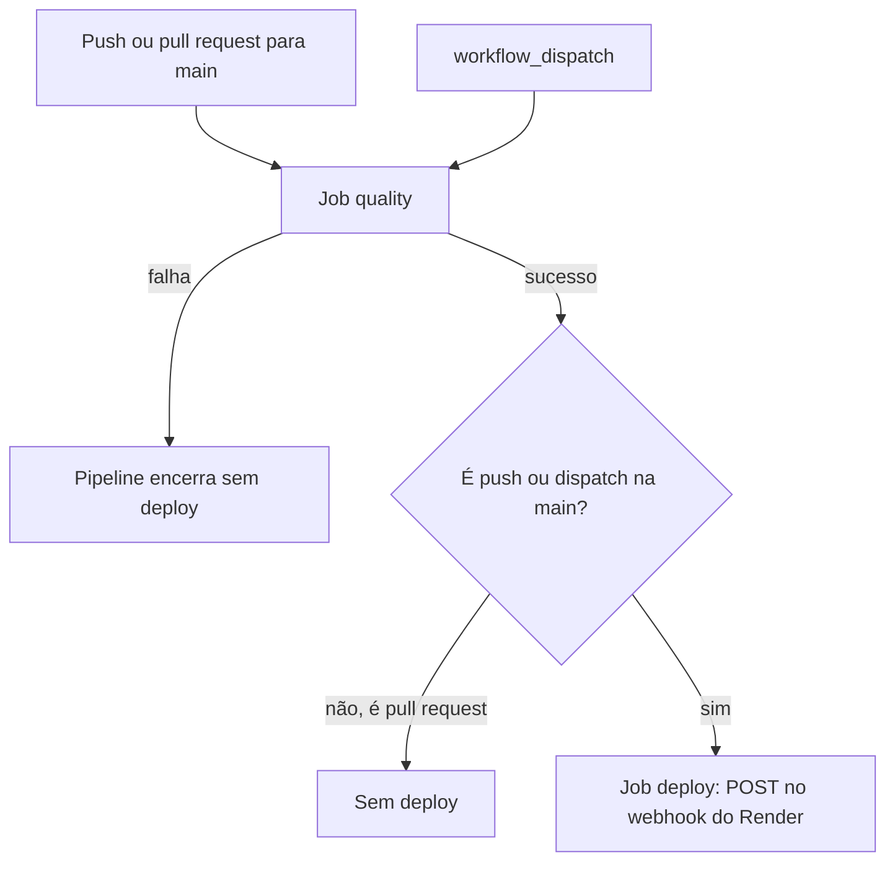

# CI — Integração Contínua

Documentação do pipeline de CI/CD deste projeto. O workflow fica em
[`.github/workflows/ci.yml`](../.github/workflows/ci.yml) e roda no GitHub Actions.

## Visão geral

O pipeline tem dois jobs:

1. **`quality`** — garante que o código está lintado, tipado, testado e compila.
2. **`deploy`** — dispara o deploy no Render via webhook, somente após o `quality`
   passar em um push para `main`.



## Quando o workflow executa

| Evento | Condição | Executa `quality`? | Executa `deploy`? |
|---|---|---|---|
| `push` | branch `main` | Sim | Sim, se `quality` passar |
| `pull_request` | destino `main` | Sim | Não |
| `workflow_dispatch` | branch `main` | Sim | Sim, se `quality` passar |
| `push` | outras branches | Não | Não |

O workflow pode ser executado manualmente em **Actions → CI → Run workflow**.

## Configuração global

```yaml
concurrency:
  group: ci-${{ github.ref }}
  cancel-in-progress: true
```

- Uma nova execução na mesma ref cancela a anterior.
- Em pull requests, pushes adicionais cancelam a execução antiga.

```yaml
permissions:
  contents: read

env:
  NEXT_TELEMETRY_DISABLED: "1"
```

- O workflow tem apenas permissão de leitura no repositório.
- A telemetria do Next.js fica desativada durante o CI.

## Job `quality`

**Nome:** `Lint, tipos, testes e build`  
**Runner:** `ubuntu-latest`  
**Timeout:** 20 minutos

### Passos

| Passo | Comando/ação | O que valida |
|---|---|---|
| Checkout | `actions/checkout@v7` | Baixa o código |
| Configurar Node.js | `actions/setup-node@v7` | Node 24 + cache do npm |
| Instalar dependências | `npm ci` | Instala exatamente o `package-lock.json` |
| Lint | `npm run lint` | ESLint em todo o projeto |
| Verificar tipos | `npm run typecheck` | `next typegen && tsc --noEmit` |
| Testes com cobertura | `npm run test:coverage` | Vitest + React Testing Library |
| Build de produção | `npm run build` | Build do Next.js |
| Publicar cobertura | `actions/upload-artifact@v7` | Sobe a pasta `coverage/` |

### Detalhes importantes

- **`npm ci`** é usado em vez de `npm install` para instalar exatamente as versões
  do lockfile e falhar se `package.json` e `package-lock.json` estiverem
  dessincronizados.
- **`npm run typecheck`** executa primeiro `next typegen`, porque o Next.js gera
  tipos de rota (por exemplo `LayoutProps`) que o `tsc` precisa encontrar.
- **Cobertura:** o relatório HTML fica em `coverage/index.html` localmente e é
  publicado como artifact `coverage-report` por 7 dias.
- **Threshold de cobertura:** não há limite mínimo configurado. O job falha se
  algum teste falhar, não por percentual de cobertura.
- Os testes atuais cobrem todas as telas, componentes compartilhados e a camada
  `lib/`. Para detalhes, veja a seção de testes no `README.md`.

## Job `deploy`

**Nome:** `Deploy no Render`  
**Runner:** `ubuntu-latest`  
**Timeout:** 5 minutos  
**Dependência:** `needs: quality`

### Condição de execução

```yaml
if: ${{ github.ref == 'refs/heads/main' && github.event_name != 'pull_request' }}
```

O deploy **não roda**:

- em pull requests;
- em pushes para branches que não sejam `main`;
- se o job `quality` falhar ou for cancelado.

O deploy também pode ser disparado manualmente via `workflow_dispatch` quando a
execução for feita na `main`.

### Secret necessário

O job usa o secret de repositório:

```text
RENDER_DEPLOY_HOOK_URL
```

Cadastro:

1. No Render, abra o serviço → **Settings → Deploy Hook**.
2. Copie a URL completa do deploy hook.
3. No GitHub, abra **Settings → Secrets and variables → Actions**.
4. Clique em **New repository secret**.
5. Nome: `RENDER_DEPLOY_HOOK_URL`.
6. Valor: a URL copiada do Render.

> O secret deve ser de **repositório**, não de environment, pois o job não usa um
> environment do GitHub.

### Fluxo do job

1. **Validar secret** — falha com mensagem explícita se
   `RENDER_DEPLOY_HOOK_URL` estiver vazio.
2. **Disparar deploy** — executa:

   ```bash
   curl --fail --silent --show-error --max-time 30 \
     --request POST \
     "$RENDER_DEPLOY_HOOK_URL"
   ```

O valor do secret não é impresso nos logs. O `--fail` garante que respostas HTTP
de erro (4xx/5xx) falhem o job.

### Auto-Deploy no Render

Se o Render estiver com **Auto-Deploy** habilitado para a branch `main`, cada push
pode gerar dois deploys: um automático e outro disparado pelo CI. Recomenda-se
desabilitar o Auto-Deploy e deixar o GitHub Actions como única origem dos deploys.

## Como reproduzir o CI localmente

Execute na raiz do projeto:

```bash
npm ci
npm run lint
npm run typecheck
npm run test
npm run build
```

Para gerar a cobertura como no CI:

```bash
npm run test:coverage
```

Depois abra `coverage/index.html` no navegador.

## Artefatos

| Nome | Conteúdo | Retenção |
|---|---|---|
| `coverage-report` | Relatório HTML/JSON da cobertura do Vitest | 7 dias |

O artifact é enviado mesmo se os testes falharem (`if: always()`), desde que a
pasta `coverage/` tenha sido criada. Se não houver arquivos, o upload é ignorado
(`if-no-files-found: ignore`).

## Estrutura relacionada

```text
.github/workflows/ci.yml   # Pipeline
vitest.config.mts          # Configuração do Vitest e cobertura
vitest.setup.ts            # jest-dom e limpeza entre testes
src/__tests__/             # Testes das telas, componentes e lib
src/test/                  # Fixtures e helpers de render
```

## Solução de problemas

### O job de deploy falhou com "Secret ausente"

Cadastre o secret `RENDER_DEPLOY_HOOK_URL` conforme a seção acima. O nome precisa
ser exatamente esse.

### O webhook retorna 401/404

A URL do deploy hook pode ter sido regenerada ou revogada no Render. Gere uma nova
URL em **Settings → Deploy Hook** e atualize o secret no GitHub.

### O workflow não rodou em uma branch de feature

Isso é esperado: pushes só disparam o workflow na `main`. Para validar uma branch,
abra um pull request para `main`. O job `quality` roda, mas o `deploy` é ignorado.

### Erro de permissão ao atualizar o workflow

Se o push for rejeitado com uma mensagem sobre o escopo `workflow`:

```text
refusing to allow an OAuth App to create or update workflow
```

O token usado pelo Git não tem permissão para alterar arquivos em
`.github/workflows/`. Com GitHub CLI:

```bash
gh auth refresh -s workflow
```

Depois faça o push novamente. Alternativamente, use um personal access token com
o escopo `workflow`.

### `npm ci` falha por lockfile dessincronizado

Rode `npm install` localmente, valide os testes e faça commit do
`package-lock.json` atualizado.

### Erro de tipos com `LayoutProps`

Execute `npm run typecheck`; o script já roda `next typegen` antes do `tsc`. Se o
erro persistir, apague `.next/` e rode novamente.

## Segurança

- O job `quality` tem apenas `contents: read`.
- O deploy só pode ser disparado a partir da `main`.
- Pull requests de forks não recebem secrets e não executam o deploy.
- O secret do Render não é ecoado nos logs.
- Nunca imprima `RENDER_DEPLOY_HOOK_URL` em passos de debug.
